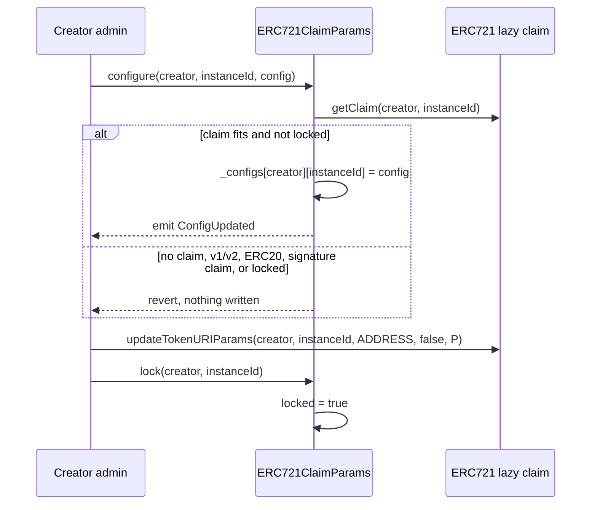
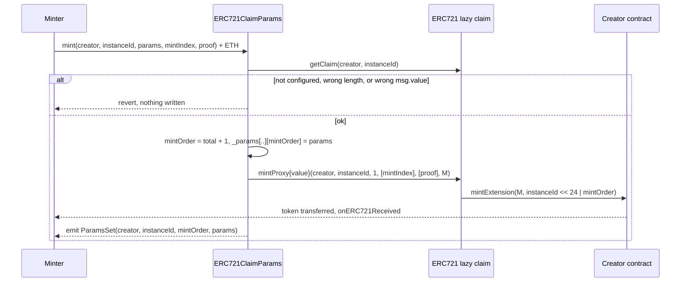
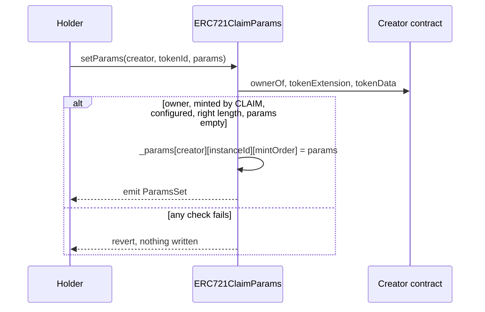
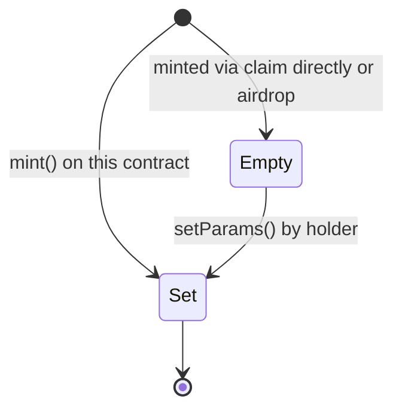

# ERC721 claim params: engineering spec

| | |
|---|---|
| Owner | Don (design), StudioGM (build) |
| Status | Draft rev 1, 2026-11-18 |
| Repos | creator-core-extensions-solidity (new package `packages/claimparams`) |

## Summary

- A collector mints a token from an existing ERC721 lazy claim and stores a few bytes of **params** for that token in the same transaction, with one signature.
- The same contract is the claim's metadata source: the claim points at it with `StorageProtocol.ADDRESS`, and it builds each token's `tokenURI` from the instance config plus that token's params.
- An off-chain renderer (for example an HTML page on Arweave) gets the params in the `image` and `animation_url` query string and draws the token from them.
- Params are set once per token and never change. The creator can edit the renderer config until they lock it.
- One deploy per chain serves every creator contract and claim instance, keyed by `(creatorContract, instanceId)`.

**Params:** raw bytes the minter chooses, with a fixed length per instance. The contract stores and returns them without decoding them. Only the renderer knows the byte layout.

**Mint order:** the claim's 1-based counter for a token (`Claim.total` after its mint). Params are keyed by mint order, not token id, because the claim passes mint order to the metadata hook.

## Data model

Contract storage, no upgrades, no owner:

| Storage | Why we store it |
|---|---|
| `CLAIM` (immutable) | The ERC721 lazy claim extension this contract mints through. A claim on another extension version needs its own deploy. |
| `_configs`, keyed by creator contract and instance | The renderer config the creator sets (`name`, `description`, `imageURI`, `animationURI`, `paramsLength`, `locked`). `tokenURI` can't be built without it. |
| `_params`, keyed by creator contract, instance and mint order | Each token's params. They are the token's content and can't be rebuilt from anything else. |

```solidity
struct Config {
    uint16 paramsLength;   // exact byte length every token's params must have, > 0
    bool locked;           // once true, Config can't change
    string name;           // token name prefix, rendered as "<name> #<mintOrder>"
    string description;
    string imageURI;       // renderer base for "image"; empty = field omitted
    string animationURI;   // renderer base for "animation_url"; empty = field omitted
}

IERC721LazyPayableClaim public immutable CLAIM;
mapping(address => mapping(uint256 => Config)) private _configs;
mapping(address => mapping(uint256 => mapping(uint24 => bytes))) private _params;
```

- Params of 32 bytes or more cost one length slot plus one slot per 32 bytes. 64-byte params are 3 new slots per mint.

## Flows

### Configure an instance

- **Creator admin only.** `configure` and `lock` require `IAdminControl(creatorContract).isAdmin(msg.sender)`, the same check the claim uses for `updateTokenURIParams`.
- **Claim must fit.** `configure` reads `CLAIM.getClaim(creatorContract, instanceId)` and reverts unless the claim exists, `contractVersion >= 3`, `erc20 == address(0)` and `signingAddress == address(0)`. `mintProxy` can't charge ERC20 to this contract or mint signature claims, and v3 is needed to find a token's mint order from `tokenData`.
- **Point the claim here.** The admin calls `CLAIM.updateTokenURIParams(creatorContract, instanceId, StorageProtocol.ADDRESS, false, <20-byte address of this contract>)` on the claim. This contract does not call it.
- **Lock is one-way.** `lock` sets `locked = true`. After it, `configure` reverts. Params writes are not affected.



### Mint with params

- **One call.** `mint(creatorContract, instanceId, params, mintIndex, merkleProof)` is payable and mints one token to `msg.sender`.
- **Exact price.** `msg.value` must equal `claim.cost + fee`, where `fee` is `CLAIM.MINT_FEE_MERKLE()` if the claim has a merkle root and `CLAIM.MINT_FEE()` if not. `mintProxy` always charges the fee and keeps any overpayment, so an exact check stops overpaid ETH from getting stuck.
- **Write before the mint call.** The mint order is `getClaim().total + 1`, read before `mintProxy`. The claim increments `total` before it mints, and the mint's `onERC721Received` callback can re-enter, so any re-entrant mint gets a later mint order. Params are written first, then `mintProxy` is called. If the claim reverts, the write reverts with it.
- **Claim rules still apply.** Start and end dates, `totalMax`, `walletMax` and the allowlist are checked by the claim against `mintFor = msg.sender`. Allowlist claims pass `mintIndex` and `merkleProof` through as one-element arrays; open claims pass empty arrays.



### Set params on a token minted elsewhere

- **Why it exists.** Anyone can still mint through the claim directly, and the admin can `airdrop`. Those tokens have no params.
- **Holder only, once.** `setParams(creatorContract, tokenId, params)` requires `ownerOf(tokenId) == msg.sender`, `tokenExtension(tokenId) == CLAIM`, a configured instance, the right length, and empty params for that token.
- **Instance and mint order come from the token.** `tokenData(tokenId)` gives `instanceId << 24 | mintOrder`. The `tokenExtension` check stops a token from another extension on the same contract from writing into a claim's mint orders.



### Token params lifecycle



### Render tokenURI

- **Called by the claim.** The claim's `tokenURI(creator, tokenId)` calls `tokenURI(creatorContract, tokenId, instanceId, mintOrder)` on this contract.
- **Output.** `data:application/json;base64,` of:

```json
{
  "name": "<name> #<mintOrder>",
  "description": "<description>",
  "image": "<imageURI>?params=0x<hex>&mintOrder=<mintOrder>",
  "animation_url": "<animationURI>?params=0x<hex>&mintOrder=<mintOrder>",
  "params": "0x<hex>"
}
```

- **Empty params** render as `params=0x`, so the renderer can show an empty state.
- **Fields with an empty base URI** are left out.

## Rules

- **Price.** Same as the claim: `cost` plus the claim's mint fee, no fee from this contract. The contract never holds ETH after a call.
- **ERC721 claims only.** An ERC1155 claim gives every mint the same token id, so params can't be stored per token.
- **One token per `mint` call.** Params are per token.
- **Params are permanent.** No function changes or deletes params once set, including for the creator.
- **Creator's escape hatch.** The creator admin can always repoint the claim's `tokenURI` with `updateTokenURIParams`. Params stay in this contract but stop showing. Lock here does not prevent that.
- **Config strings go into the JSON as they are.** The admin passes JSON-safe strings. The contract does not escape them.
- **No owner, no upgrades, no pause.**

## API

| Function | Caller | Purpose |
|---|---|---|
| `constructor(address claim)` | deployer | Sets `CLAIM`. |
| `configure(address creatorContract, uint256 instanceId, Config calldata config)` | creator admin | Sets the instance config. Reverts when locked, when the claim doesn't fit, or when `paramsLength == 0`. Emits `ConfigUpdated`. |
| `lock(address creatorContract, uint256 instanceId)` | creator admin | Freezes the config. Emits `ConfigLocked`. |
| `mint(address creatorContract, uint256 instanceId, bytes calldata params, uint32 mintIndex, bytes32[] calldata merkleProof)` | anyone, payable | Mints one token to `msg.sender` through `CLAIM.mintProxy` and stores its params. Emits `ParamsSet`. |
| `setParams(address creatorContract, uint256 tokenId, bytes calldata params)` | token holder | Sets params once on a token that has none. Emits `ParamsSet`. |
| `tokenURI(address creatorContract, uint256 tokenId, uint256 instanceId, uint24 mintOrder)` | claim, view | `IERC721LazyPayableClaimMetadata`. Returns the JSON above. |
| `getConfig(address creatorContract, uint256 instanceId)` | view | Returns `Config`. |
| `getParams(address creatorContract, uint256 instanceId, uint24 mintOrder)` | view | Returns the params, empty if not set. |
| `mintPrice(address creatorContract, uint256 instanceId)` | view | Returns the exact `msg.value` for `mint`, so a frontend doesn't compute fees. |

Events:

```solidity
event ConfigUpdated(address indexed creatorContract, uint256 indexed instanceId);
event ConfigLocked(address indexed creatorContract, uint256 indexed instanceId);
event ParamsSet(address indexed creatorContract, uint256 indexed instanceId, uint24 indexed mintOrder, bytes params);
```

`supportsInterface` returns true for `IERC721LazyPayableClaimMetadata` and ERC-165.

## Changes per repo

| Repo | Change |
|---|---|
| creator-core-extensions-solidity | New package `packages/claimparams`: `ERC721ClaimParams.sol`, `IERC721ClaimParams.sol`, Foundry tests, deploy script, `foundry.toml`, `remappings.txt`, `forge-std` submodule. It imports the claim interfaces from `@manifoldxyz/creator-core-extensions-solidity` and `Base64` and `Strings` from OpenZeppelin. No existing file changes. |

## Rollout

| Step | Safe alone because | Revert |
|---|---|---|
| 1. Merge the package with tests | New files only. Nothing calls it. | Delete the package. |
| 2. Deploy on Sepolia with `CLAIM` = the live Sepolia ERC721 claim extension, then run an end-to-end mint on a v3 test contract | Testnet | Not needed |
| 3. Deploy on mainnet | No owner and no funds held. A deploy changes nothing until a creator points a claim at it. | Creator repoints the claim with `updateTokenURIParams`. Per instance. |
| 4. Creator configures, points the claim here, then locks | Config is editable until lock. | Before lock: `configure` again. After lock: only repointing the claim. **Point of no return is `lock`.** |

## Risks

- **K1 Direct claim mints have no params.** The claim's own `mint` and `mintProxy` stay open, and so does any hosted page for the claim. Those tokens render the empty state until the holder calls `setParams`. Keep the claim's hosted page unshared.
- **K2 The creator can repoint metadata.** `updateTokenURIParams` is creator-admin only on the claim and can't be locked from here. Say "permanent unless the creator repoints it".
- **K3 Claim extension version.** `CLAIM` is fixed per deploy. A claim created on a newer extension needs a new deploy of this contract.
- **K4 Unescaped config strings.** A `"` in `description` breaks the JSON. Only the creator's own tokens are affected, and the creator can fix it with `configure` before `lock`.
- **K5 Renderer availability.** The params are on chain, but the image depends on the renderer URL staying up. Arweave renderers don't expire.

## Tests

- **Mint stores params.** `mint` on an open claim mints to the caller, stores params at the mint order, emits `ParamsSet`, and `tokenURI` returns the expected JSON.
- **Exact price.** `msg.value` one wei over or under `mintPrice` reverts. After a mint, this contract's balance is 0.
- **Allowlist claim.** A valid `mintIndex` and proof mint, an invalid proof reverts, and the merkle fee is charged.
- **Claim limits.** `walletMax`, `totalMax`, and start and end dates revert through `mint` the same as through the claim.
- **Re-entrant mint.** A contract minter that calls `mint` again from `onERC721Received` gets two tokens, each with its own params at its own mint order.
- **Length.** Params shorter or longer than `paramsLength` revert on `mint` and `setParams`.
- **Unconfigured, ERC20, signature, or v2 claim.** `configure` reverts for each, and `mint` reverts on an unconfigured instance.
- **Holder fallback.** A direct claim mint has empty params. Its holder sets them once. A second `setParams` reverts, a non-holder reverts, and a token from another extension on the same contract reverts.
- **Mint never overwrites.** Params set by `mint` can't be changed by `setParams` or a later `mint`.
- **Config admin.** A non-admin `configure` or `lock` reverts. After `lock`, `configure` reverts and `setParams` still works.
- **Empty params and empty URIs.** `tokenURI` renders `params=0x` and leaves out `image` or `animation_url` when its base is empty.
- **Fork test.** On a Sepolia fork against the live ERC721 claim extension and a v3 creator contract: configure, point the claim, mint, and read `tokenURI` through the creator contract.
