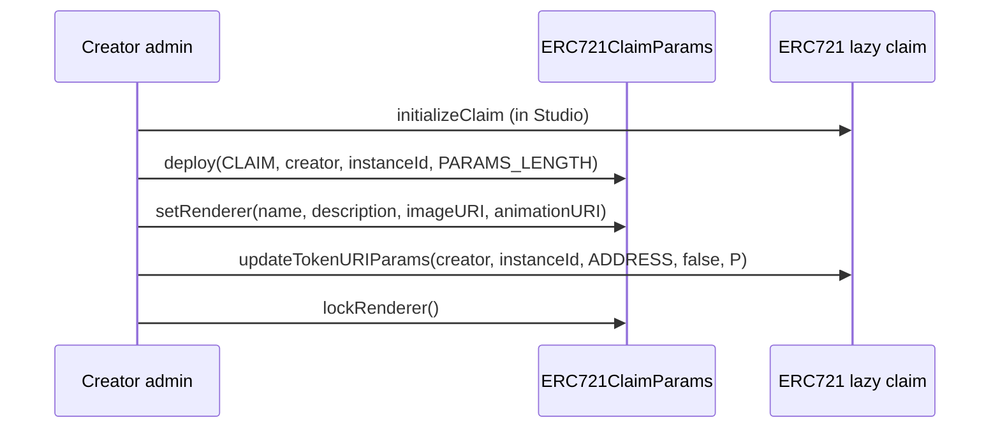
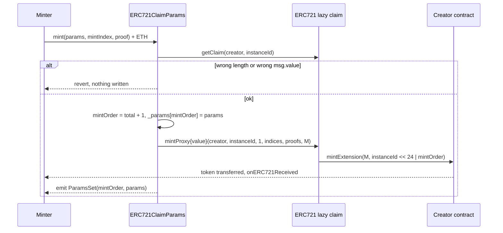
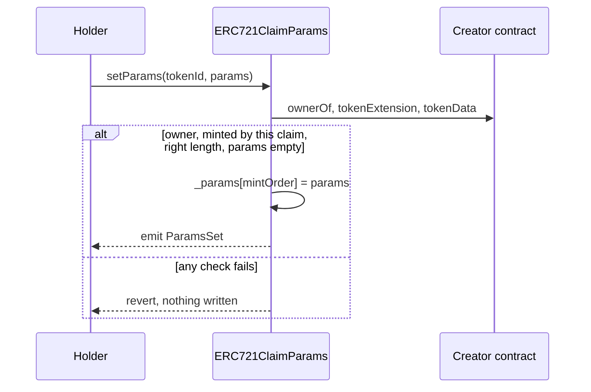
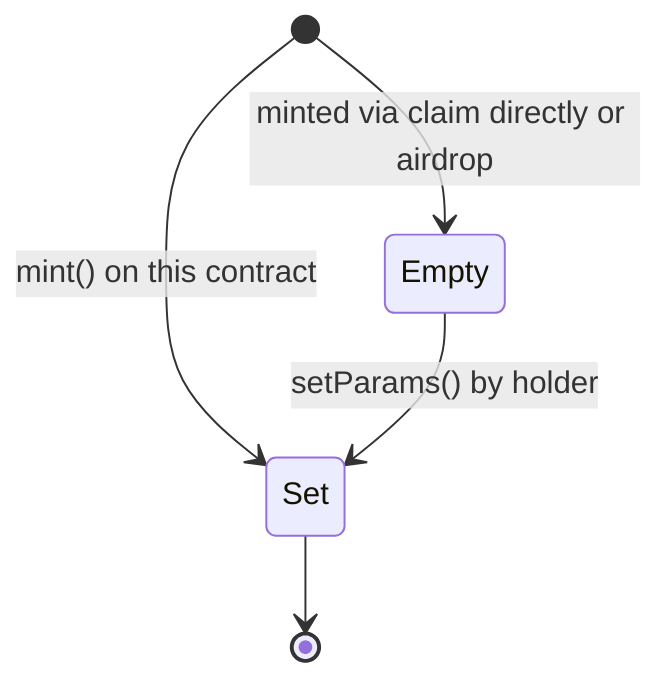

# ERC721 claim params: engineering spec

| | |
|---|---|
| Owner | Don (design), StudioGM (build) |
| Status | Draft rev 3, 2026-11-18 (single claim) |
| Repos | creator-core-extensions-solidity (new package `packages/claimparams`) |

## Summary

- One deploy serves one ERC721 lazy claim: one creator contract and one instance, fixed at deploy.
- A collector mints from that claim and stores a few bytes of **params** for the token in the same transaction, with one signature.
- The same contract is the claim's metadata source: the claim points at it with `StorageProtocol.ADDRESS`, and it builds each token's `tokenURI` from the renderer settings plus that token's params.
- An off-chain renderer (for example an HTML page on Arweave) gets the params in the `animation_url` query string and draws the token from them. `image` is one static preview shared by every token.
- Params are set once per token and never change. The creator admin can edit the renderer settings until they lock them.

**Params:** raw bytes of a fixed length (`PARAMS_LENGTH`) that the minter chooses. The contract stores and returns them without decoding them. Only the renderer knows the byte layout.

**Mint order:** the claim's 1-based counter for a token (`Claim.total` after its mint). Params are keyed by mint order, not token id, because the claim passes mint order to the metadata hook.

## Data model

| Storage | Why we store it |
|---|---|
| `CLAIM`, `CREATOR_CONTRACT`, `INSTANCE_ID`, `PARAMS_LENGTH` (immutable) | The one claim this contract mints through and renders for, and the exact params size. Set in the constructor. |
| `renderer` | The name, description, preview image and renderer URI the creator admin sets. `tokenURI` can't be built without them. |
| `locked` | Once true, `renderer` can't change. |
| `_params`, keyed by mint order | Each token's params. They are the token's content and can't be rebuilt from anything else. |

```solidity
struct Renderer {
    string name;           // rendered as "<name> #<mintOrder>"
    string description;
    string imageURI;       // static preview, same for every token
    string animationURI;   // renderer base; params go in its query string
}

IERC721LazyPayableClaim public immutable CLAIM;
address public immutable CREATOR_CONTRACT;
uint256 public immutable INSTANCE_ID;
uint16 public immutable PARAMS_LENGTH;

Renderer public renderer;
bool public locked;
mapping(uint24 => bytes) private _params;
```

- Params of 32 bytes or more cost one length slot plus one slot per 32 bytes. 64-byte params are 3 new slots per mint.

## Flows

### Deploy and set up

- **Claim first.** The creator makes the ERC721 claim in Studio. Its instance id goes into the constructor with the claim extension address, the creator contract and `PARAMS_LENGTH`.
- **The deploy script checks the claim.** Before sending, it reads `getClaim` and stops unless `contractVersion >= 3`, `erc20 == address(0)` and `signingAddress == address(0)`. `mintProxy` can't charge ERC20 to this contract or mint signature claims, and v3 is needed to find a token's mint order from `tokenData`. The contract itself doesn't repeat these checks.
- **Creator admin only.** `setRenderer` and `lockRenderer` require `IAdminControl(CREATOR_CONTRACT).isAdmin(msg.sender)`. The contract has no owner.
- **Point the claim here.** The admin calls `CLAIM.updateTokenURIParams(CREATOR_CONTRACT, INSTANCE_ID, StorageProtocol.ADDRESS, false, <20-byte address of this contract>)`.
- **Lock is one-way.** After `lockRenderer`, `setRenderer` reverts. Params writes are not affected.



### Mint with params

- **One call.** `mint(params, mintIndex, merkleProof)` is payable and mints one token to `msg.sender`.
- **Exact price.** `msg.value` must equal `mintPrice()`, which is `claim.cost` plus `CLAIM.MINT_FEE_MERKLE()` if the claim has a merkle root, or `CLAIM.MINT_FEE()` if not. Both are read live, so the creator can add or remove an allowlist mid-sale. `mintProxy` always charges the fee and keeps any overpayment, so an exact check stops overpaid ETH from getting stuck.
- **Allowlist.** With a merkle root, `mintIndex` and `merkleProof` pass through as one-element arrays, and the claim checks the leaf for `msg.sender` (`mintFor`). With no root, the call passes empty arrays and the two arguments are ignored.
- **Write before the mint call.** The mint order is `getClaim().total + 1`, read before `mintProxy`. The claim increments `total` before it mints, and the mint's `onERC721Received` callback can re-enter, so a re-entrant mint gets a later mint order. Params are written first, then `mintProxy` is called. If the claim reverts, the write reverts with it.
- **Claim rules still apply.** Start and end dates, `totalMax`, `walletMax` and the allowlist are all checked by the claim.



### Set params on a token minted elsewhere

- **Why it exists.** Anyone can still mint through the claim directly, and the admin can `airdrop`. Those tokens have no params.
- **Holder only, once.** `setParams(tokenId, params)` requires `ownerOf(tokenId) == msg.sender` on `CREATOR_CONTRACT`, `tokenExtension(tokenId) == CLAIM`, an instance id in `tokenData(tokenId)` equal to `INSTANCE_ID`, the right length, and empty params for that mint order.
- **Why the extension and instance checks.** Other extensions and other claims on the same creator contract also mint tokens. Without the checks, their holders could write into this claim's mint orders.



### Token params lifecycle



### Render tokenURI

- **Called by the claim.** The claim's `tokenURI(creator, tokenId)` calls `tokenURI(creatorContract, tokenId, instanceId, mintOrder)` here. Only `mintOrder` is used.
- **Output.** `data:application/json;base64,` of:

```json
{
  "name": "<name> #<mintOrder>",
  "description": "<description>",
  "image": "<imageURI>",
  "animation_url": "<animationURI>?params=0x<hex>&mintOrder=<mintOrder>"
}
```

- **Empty params** render as `params=0x`, so the renderer can show an empty state.
- **Why `image` is static.** Marketplaces need a real image file there, and a static file ignores a query string. The live token is `animation_url`.

## Rules

- **Price.** Same as the claim: `cost` plus the claim's mint fee. This contract charges no fee and never holds ETH after a call.
- **One claim per deploy.** Another claim needs its own deploy.
- **ERC721 only.** An ERC1155 claim gives every mint the same token id, so params can't be stored per token.
- **One token per `mint` call.** Params are per token.
- **Params are permanent.** No function changes or deletes params once set, including for the creator.
- **Creator's escape hatch.** The creator admin can always repoint the claim's `tokenURI` with `updateTokenURIParams`. Params stay in this contract but stop showing. `lockRenderer` does not prevent that.
- **Renderer strings go into the JSON as they are.** The admin passes JSON-safe strings. The contract does not escape them.
- **No owner, no upgrades, no pause.**

## API

| Function | Caller | Purpose |
|---|---|---|
| `constructor(address claim, address creatorContract, uint256 instanceId, uint16 paramsLength)` | deployer | Sets the immutables. `paramsLength` must be > 0. |
| `setRenderer(Renderer calldata renderer)` | creator admin | Sets the name, description and URIs. Reverts after lock. Emits `RendererUpdated`. |
| `lockRenderer()` | creator admin | Freezes the renderer settings. Emits `RendererLocked`. |
| `mint(bytes calldata params, uint32 mintIndex, bytes32[] calldata merkleProof)` | anyone, payable | Mints one token to `msg.sender` through `CLAIM.mintProxy` and stores its params. Emits `ParamsSet`. |
| `setParams(uint256 tokenId, bytes calldata params)` | token holder | Sets params once on a token that has none. Emits `ParamsSet`. |
| `tokenURI(address creatorContract, uint256 tokenId, uint256 instanceId, uint24 mintOrder)` | claim, view | `IERC721LazyPayableClaimMetadata`. Returns the JSON above. |
| `mintPrice()` | view | The exact `msg.value` for `mint`, so a frontend doesn't compute fees. |
| `getParams(uint24 mintOrder)` | view | The params, empty if not set. |

Events:

```solidity
event RendererUpdated();
event RendererLocked();
event ParamsSet(uint24 indexed mintOrder, bytes params);
```

`supportsInterface` returns true for `IERC721LazyPayableClaimMetadata` and ERC-165.

## Changes per repo

| Repo | Change |
|---|---|
| creator-core-extensions-solidity | New package `packages/claimparams`: `ERC721ClaimParams.sol`, `IERC721ClaimParams.sol`, Foundry tests, a deploy script that checks the claim, `foundry.toml`, `remappings.txt`, `forge-std` submodule. Claim interfaces from `@manifoldxyz/creator-core-extensions-solidity`; `Base64` and `Strings` from OpenZeppelin. No existing file changes. |

## Rollout

| Step | Safe alone because | Revert |
|---|---|---|
| 1. Merge the package with tests | New files only. Nothing calls it. | Delete the package. |
| 2. Sepolia: make a claim on a v3 test contract, deploy, point the claim, mint (open and allowlist) | Testnet | Not needed |
| 3. Mainnet: make the claim, deploy, `setRenderer`, point the claim | Holds no funds and has no owner. Nothing shows until the claim points here. | Repoint the claim with `updateTokenURIParams`. |
| 4. `lockRenderer` | Params are already safe without it. | None. **Point of no return.** |

## Risks

- **K1 Direct claim mints have no params.** The claim's own `mint` and `mintProxy` stay open, and so does any hosted page for the claim. Those tokens render the empty state until the holder calls `setParams`. Keep the claim's hosted page unshared.
- **K2 The creator can repoint metadata.** `updateTokenURIParams` is creator-admin only on the claim and can't be locked from here. Say "permanent unless the creator repoints it".
- **K3 Claim settings change after deploy.** If the creator later adds a signer, `mint` reverts on the claim. Only the creator can cause it, and removing the signer fixes it.
- **K4 Unescaped renderer strings.** A `"` in `description` breaks the JSON. The creator can fix it with `setRenderer` before lock.
- **K5 Renderer availability.** The params are on chain, but the live token depends on the renderer URL staying up. Arweave renderers don't expire.
- **K6 One preview for all tokens.** Marketplace grids show the same `image` for every token until someone opens it. A per-token image would need an SVG built on chain.

## Tests

- **Mint stores params.** `mint` on an open claim mints to the caller, stores params at the mint order, emits `ParamsSet`, and `tokenURI` through the creator contract returns the expected JSON.
- **Exact price.** `msg.value` one wei over or under `mintPrice()` reverts. After a mint, this contract's balance is 0.
- **Allowlist.** With a merkle root, a valid `mintIndex` and proof mint and pay the merkle fee. An invalid proof, someone else's leaf, or a reused index reverts.
- **Claim limits.** `walletMax`, `totalMax`, and the start and end dates revert through `mint` the same as through the claim.
- **Re-entrant mint.** A contract minter that calls `mint` again from `onERC721Received` gets two tokens, each with its own params at its own mint order.
- **Length.** Params shorter or longer than `PARAMS_LENGTH` revert on `mint` and `setParams`.
- **Holder fallback.** A direct claim mint has empty params, and its holder sets them once. A second `setParams` reverts, and so does a non-holder. A token from another extension, or from another claim on the same contract, also reverts.
- **Mint never overwrites.** Params set by `mint` can't be changed by `setParams` or a later `mint`.
- **Renderer admin.** A non-admin `setRenderer` or `lockRenderer` reverts. After lock, `setRenderer` reverts and `setParams` still works.
- **Empty params.** A token with no params renders `params=0x` in `animation_url` and the same static `image`.
- **Fork test.** On a Sepolia fork against the live ERC721 claim extension and a v3 creator contract: deploy, point the claim, mint, and read `tokenURI` through the creator contract.
