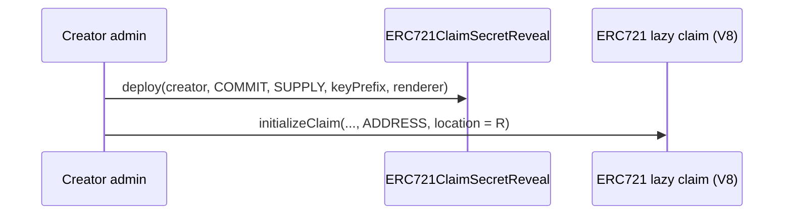
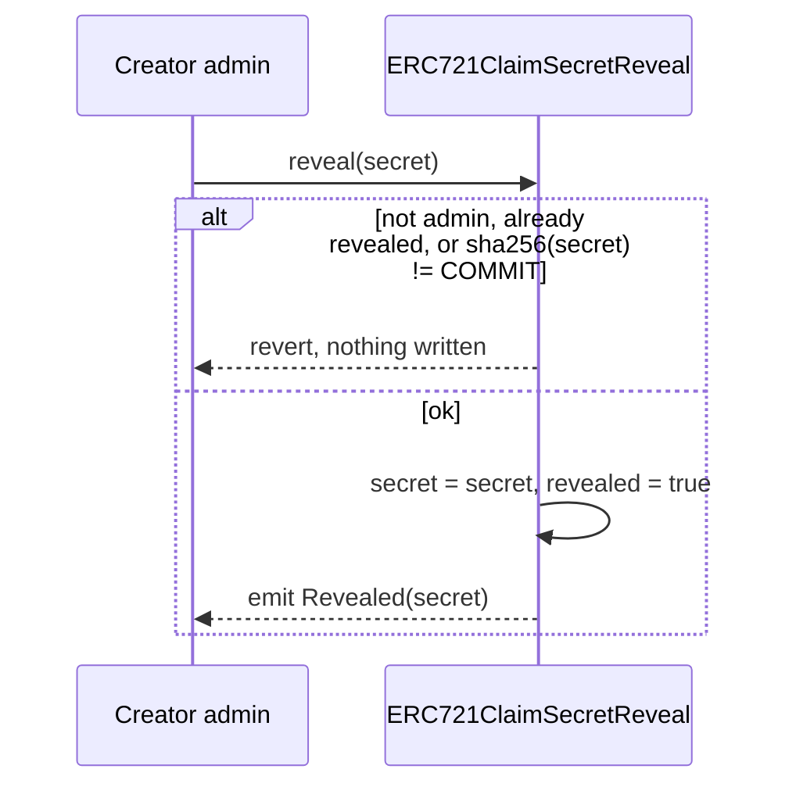

# ERC721 claim secret reveal: engineering spec

| | |
|---|---|
| Owner | Don (design), StudioGM (build) |
| Status | Built, rev 1, 2026-11-27 |
| Repos | creator-core-extensions-solidity (new package `packages/claimsecretreveal`) |

## Summary

- A `tokenURI` source for ERC721 lazy claims. The claim points at it with `StorageProtocol.ADDRESS`, and the claim's `tokenURI` calls it with the token's mint order.
- The creator commits to a 32-byte secret at deploy: `COMMIT = sha256(secret)`.
- Until the reveal, every token renders the same cover: name, description and a static `image`, no `animation_url`.
- After the claim closes, a creator contract admin calls `reveal(secret)` once. The contract checks it against `COMMIT` and stores it.
- From then on each token's `animation_url` is `<animationURI>?payload=<base64 JSON>`. The JSON carries a key and a hash derived from the secret and the token's mint order. An off-chain renderer (for example an HTML generator on Arweave) checks the key and draws the token.
- Nothing is written per token. One transaction reveals every token.

**Edition:** the token's mint order, 1 to `SUPPLY`. The claim passes mint order to the metadata hook, so mint order is the edition number.

**Key:** `HMAC-SHA256(secret, keyPrefix + decimal(edition))`, 32 bytes, rendered as 64 lowercase hex characters. `keyPrefix` is a constructor string, so the contract matches whatever message format the renderer's key tool uses.

**Hash:** `keccak256(abi.encodePacked(secret, uint256(edition)))`, rendered as `0x` plus 64 lowercase hex characters. It is fixed by the commit, so no one, the creator included, can change any token's output after deploy.

## Data model

| Storage | Why we store it |
|---|---|
| `CREATOR_CONTRACT` (immutable) | Whose admins may reveal. |
| `COMMIT` (immutable) | `sha256(secret)`. `reveal` only accepts the matching secret. |
| `SUPPLY` (immutable) | Highest edition. Mint orders past it keep the cover, because the renderer has no edition for them. |
| `renderer` | Name, description, cover image, renderer URI. `tokenURI` can't be built without them. Set in the constructor, no setter. |
| `keyPrefix` | Message prefix for the key HMAC. Set in the constructor, no setter. |
| `revealed`, `secret` | Whether the reveal happened, and the secret every key and hash is derived from. Written once. |

```solidity
struct Renderer {
    string name;           // rendered as "<name> #<mintOrder>"
    string description;
    string imageURI;       // static cover, same for every token
    string animationURI;   // renderer base; "?payload=..." is appended after the reveal
}

address public immutable CREATOR_CONTRACT;
bytes32 public immutable COMMIT;
uint24 public immutable SUPPLY;

Renderer public renderer;
string public keyPrefix;
bool public revealed;
bytes32 public secret;
```

**Why no claim address or instance id.** `tokenURI` is a view that only uses `mintOrder`, and `reveal` only needs the creator contract's admin list. Neither needs the claim. Studio's Onchain artwork flow creates the claim already pointing at this contract, so the claim's instance id doesn't exist yet when this contract is deployed.

**Why no setters.** The creator's settings are final at deploy. A wrong URI is fixed by deploying a new instance with the same commit and repointing the claim (`updateTokenURIParams`). The deploy script refuses strings that would break the JSON.

## Flows

### Deploy and set up

- **Deploy first.** Constructor: creator contract, `COMMIT`, `SUPPLY`, `keyPrefix`, renderer settings.
- **Create the claim pointing here.** In Studio: an Edition on an ERC-721 contract with the Onchain artwork type, this contract as the art contract. Directly: `initializeClaim` with `StorageProtocol.ADDRESS` and the 20 raw address bytes as `location`, or `updateTokenURIParams` on an existing claim (the deploy script prints that calldata).
- **The claim extension must support `StorageProtocol.ADDRESS`.** The current lazy claim release (V8) does. The previous release (V7) rejects it.
- **Claim `totalMax` ≤ `SUPPLY`.** Tokens past `SUPPLY` keep the cover.



### Mint (unchanged)

Collectors mint through the claim as usual: the hosted page, an allowlist (merkle), `mintProxy`, `airdrop`. This contract takes no part in minting and has no mint-time state. Every token, however it was minted, renders by its mint order.

### Reveal

- **Creator contract admin only, once.** `reveal(secret)` requires `IAdminControl(CREATOR_CONTRACT).isAdmin(msg.sender)`, `!revealed` and `sha256(abi.encodePacked(secret)) == COMMIT`. It stores the secret and emits `Revealed(secret)`.
- **Admin only, although the commit already proves the secret.** If the secret leaks before the claim closes, a stranger still can't reveal on chain.
- **When.** After the claim ends or sells out. The contract doesn't check the claim's dates.



### Render tokenURI

- **Called by the claim.** The claim's `tokenURI(creator, tokenId)` calls `tokenURI(creatorContract, tokenId, instanceId, mintOrder)` here. Only `mintOrder` is used.
- **Before the reveal, or mint order 0 or past `SUPPLY`:**

```json
{"name":"<name> #<mintOrder>","description":"<description>","image":"<imageURI>"}
```

- **After the reveal, mint order 1 to `SUPPLY`:**

```json
{"name":"<name> #<mintOrder>","description":"<description>","image":"<imageURI>",
 "animation_url":"<animationURI>?payload=<base64 of {\"hash\":\"0x<64 hex>\",\"editionNumber\":<mintOrder>,\"key\":\"<64 hex>\"}>"}
```

- **Output** is `data:application/json;base64,` of that JSON.
- **Plain base64 is query-safe here.** The payload JSON is ASCII with no `>`, `?` or `~`, so its base64 never contains `+` or `/` (a `+` would read back as a space). Padding `=` is fine in a query value. A test checks every edition.
- **Why `image` stays static.** Marketplaces need a real image file there. The live token is `animation_url`.
- **Gas** (view): about 56k before the reveal and 122k after, through the creator contract.

## Rules

- **No fee, no ETH, no owner, no upgrades, no pause.**
- **One reveal.** The secret can't be replaced or hidden again.
- **Keys and hashes are deterministic.** Anyone can recompute every key and hash from the revealed secret and check them against the renderer and `COMMIT`.
- **Renderer strings go into the JSON as they are.** The deploy script rejects `"`, `\` and control characters; the contract does not escape them.
- **ERC721 only.** An ERC1155 claim gives every mint the same token id, so there is one edition per claim.

## API

| Function | Caller | Purpose |
|---|---|---|
| `constructor(address creatorContract, bytes32 commit, uint24 supply, string keyPrefix, Renderer renderer)` | deployer | Sets everything. `supply` must be > 0. |
| `reveal(bytes32 secret)` | creator admin | Publishes the secret once. Emits `Revealed`. |
| `tokenURI(address creatorContract, uint256 tokenId, uint256 instanceId, uint24 mintOrder)` | claim, view | `IERC721LazyPayableClaimMetadata`. Returns the JSON above. |
| `editionKey(uint256 edition)` | view | The key for an edition. Reverts before the reveal. |
| `editionHash(uint256 edition)` | view | The hash for an edition. Reverts before the reveal. |
| `CREATOR_CONTRACT()`, `COMMIT()`, `SUPPLY()`, `renderer()`, `keyPrefix()`, `revealed()`, `secret()` | view | Settings and state. |

`editionKey` and `editionHash` let anyone check a token without decoding its `tokenURI`.

Errors: `InvalidSupply`, `NotCreatorAdmin`, `AlreadyRevealed`, `InvalidSecret`, `NotRevealed`.

```solidity
event Revealed(bytes32 secret);
```

`supportsInterface` returns true for `IERC721ClaimSecretReveal`, `IERC721LazyPayableClaimMetadata` and ERC-165.

## Changes per repo

| Repo | Change |
|---|---|
| creator-core-extensions-solidity | New package `packages/claimsecretreveal`: `ERC721ClaimSecretReveal.sol`, `IERC721ClaimSecretReveal.sol`, unit and Sepolia fork tests, a deploy script, `foundry.toml`, `remappings.txt`, `forge-std` submodule. The claim interfaces come from `packages/manifold` through a remapping. No existing file changes. |

## Rollout

| Step | Safe alone because | Revert |
|---|---|---|
| 1. Merge the package with tests | New files only. Nothing calls it. | Delete the package. |
| 2. Sepolia: deploy, claim on V8 pointing here, mint, reveal | Testnet | Not needed |
| 3. Mainnet or Base: deploy with the creator's real commit and renderer | Holds no funds, has no owner. Nothing shows until a claim points here. | Don't point a claim at it. |
| 4. Claim on V8 pointing here (Studio Onchain artwork) | Tokens show the cover until the reveal. | Repoint with `updateTokenURIParams`. |
| 5. `reveal` after the claim closes | Checked against `COMMIT`. | None. **Point of no return.** |

## Risks

- **K1 Reveal timing.** Revealing before the claim closes exposes the key of every unminted edition. If the renderer gives some editions rarer output, minters can then pick which edition they get by timing their mint. Reveal after the claim ends or sells out.
- **K2 Secret custody.** A lost secret means tokens keep the cover forever (repointing to a new deploy needs the same secret). A leaked secret can't be revealed on chain by a stranger, but anyone holding it can compute every key off chain before the claim closes. Rotate a leaked secret before deploy.
- **K3 Settings are final.** A wrong URI or prefix means a new deploy with the same commit, repointing the claim, and revealing again on the new deploy.
- **K4 The creator can repoint metadata.** `updateTokenURIParams` is creator-admin only on the claim and can't be locked from here. Say "permanent unless the creator repoints it".
- **K5 No traits.** The JSON has no `attributes`, so marketplaces show none. The renderer may compute traits at runtime, but marketplaces read the JSON.
- **K6 One cover for all tokens.** Marketplace grids show the same `image` for every token until someone opens it.
- **K7 One contract, several claims.** Any claim pointing here renders by its own mint order, so two claims would both have an edition 1. Point one claim at it.
- **K8 Supply past `SUPPLY`.** An admin can raise the claim's `totalMax`, and an airdrop past the cap raises it. Those tokens keep the cover.
- **K9 The commit fixes every output.** The creator knows every key and hash before deploy and could pick a secret for the outputs it gives. That is the same control the creator already has over which edition gets which output.
- **K10 Renderer availability.** The live token depends on the renderer URL staying up. Arweave renderers don't expire.
- **K11 Claim on the wrong extension.** A claim on V7 can't point here. Create it on V8.

## Tests

- **Before the reveal.** Minted tokens render the cover JSON through the creator contract. `editionKey`/`editionHash` revert.
- **Reveal.** A non-admin reverts; an approved creator admin can reveal; a wrong secret reverts and leaves nothing set; the right secret emits `Revealed`; a second reveal reverts.
- **Reference vectors.** Keys for editions 1, 9, 10, 99 and 100 equal the output of an independent key tool (`node:crypto` `createHmac`); hashes equal `cast keccak`; the full `tokenURI` for those editions equals JSON and base64 built off chain.
- **After the reveal.** Tokens minted before and after the reveal render their payload through the claim; mint order 0 and `SUPPLY + 1` keep the cover; `SUPPLY` is revealed.
- **Query-safe payload.** For every edition 1 to `SUPPLY`, the payload has no `+` or `/` and is exactly what `tokenURI` carries.
- **Allowlist and airdrop.** On a merkle claim, allowlist mints and an airdrop take mint orders 1, 2-8 and 9, and each reveals by its own mint order.
- **Fork test.** On a Sepolia fork against the live V8 ERC721 claim: deploy, create the claim pointing here, mint, read the cover, reveal, read the revealed `tokenURI` and check the key. A second test shows V7 rejects `StorageProtocol.ADDRESS`.
